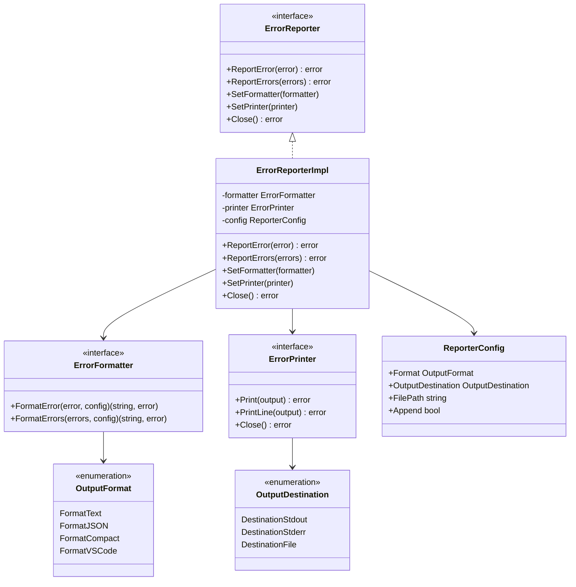
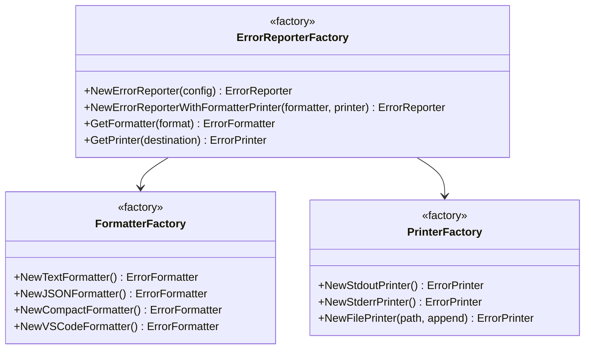

# ErrorReporter Component Design

## Overview

Design a flexible error reporting system for the GPMA CLI that supports multiple output formats, destinations, and configurable behavior. The system will replace the current error handling in [`framework/cli/main.go`](framework/cli/main.go:224-237) with a more modular and extensible approach.

## Requirements

- Support multiple output formats (text, json, compact, vscode)
- Support multiple output destinations (stdout, stderr, file)
- Handle both individual errors and batches of errors
- Fully configurable after creation
- Replace current error handling system completely
- CLI integration with flags for format and output destination

## Architecture

### Core Components



### Factory Pattern



## File Structure

```
framework/errors/
├── reporter.go              # Core interfaces and types
├── reporter_impl.go         # ErrorReporter implementation
├── reporter_factory.go      # Factory for creating reporters
├── formatter.go             # Existing formatter interface (keep)
├── printer.go               # Printer interface
├── printers/
│   ├── stream.go           # StreamPrinter implementation
│   ├── stdout.go           # Stdout factory function
│   ├── stderr.go           # Stderr factory function
│   └── file.go             # File factory function
└── formats/                 # Existing formatters (keep)
    ├── text.go
    ├── json.go
    ├── compact.go
    └── vscode.go
```

## Interface Definitions

### ErrorReporter Interface

```go
package errors

// ErrorReporter defines the interface for error reporting
type ErrorReporter interface {
    // ReportError reports a single error
    ReportError(err *Error) error
    
    // ReportErrors reports multiple errors
    ReportErrors(errs []*Error) error
    
    // SetFormatter changes the formatter dynamically
    SetFormatter(formatter ErrorFormatter)
    
    // SetPrinter changes the printer dynamically
    SetPrinter(printer ErrorPrinter)
    
    // Close closes any resources (e.g., file handles)
    Close() error
}
```

### ErrorPrinter Interface

```go
package errors

// ErrorPrinter defines the interface for output destinations
type ErrorPrinter interface {
    // Print writes the output without a newline
    Print(output string) error
    
    // PrintLine writes the output with a newline
    PrintLine(output string) error
    
    // Close closes any resources
    Close() error
}
```

### ReporterConfig

```go
package errors

// OutputDestination specifies where to send error output
type OutputDestination string

const (
    DestinationStdout OutputDestination = "stdout"
    DestinationStderr OutputDestination = "stderr"
    DestinationFile   OutputDestination = "file"
)

// ReporterConfig configures the ErrorReporter
type ReporterConfig struct {
    // Format is the output format
    Format OutputFormat
    
    // OutputDestination is where to send output
    OutputDestination OutputDestination
    
    // FilePath is the path to output file (required if Destination is file)
    FilePath string
    
    // Append determines whether to append to file or truncate
    Append bool
}
```

## Implementation Details

### ErrorReporterImpl

```go
package errors

type ErrorReporterImpl struct {
    formatter ErrorFormatter
    printer   ErrorPrinter
    config    ReporterConfig
}

func NewErrorReporter(config ReporterConfig) (*ErrorReporterImpl, error) {
    formatter := getFormatter(config.Format)
    printer, err := getPrinter(config.OutputDestination, config.FilePath, config.Append)
    if err != nil {
        return nil, err
    }
    
    return &ErrorReporterImpl{
        formatter: formatter,
        printer:   printer,
        config:    config,
    }, nil
}

func (r *ErrorReporterImpl) ReportError(err *Error) error {
    formatted, err := r.formatter.FormatError(err, FormatterConfig{Format: r.config.Format})
    if err != nil {
        return err
    }
    return r.printer.PrintLine(formatted)
}

func (r *ErrorReporterImpl) ReportErrors(errs []*Error) error {
    formatted, err := r.formatter.FormatErrors(errs, FormatterConfig{Format: r.config.Format})
    if err != nil {
        return err
    }
    return r.printer.PrintLine(formatted)
}

func (r *ErrorReporterImpl) SetFormatter(formatter ErrorFormatter) {
    r.formatter = formatter
}

func (r *ErrorReporterImpl) SetPrinter(printer ErrorPrinter) {
    r.printer = printer
}

func (r *ErrorReporterImpl) Close() error {
    return r.printer.Close()
}
```

### Printer Implementations

#### StreamPrinter

```go
package printers

import (
    "io"
    "gpma/framework/errors"
)

// StreamPrinter writes to any io.Writer (stdout, stderr, file, etc.)
type StreamPrinter struct {
    writer io.Writer
    closer io.Closer
}

// NewStreamPrinter creates a printer that writes to any io.Writer
// If the writer is also a Closer, it will be closed when Close() is called
func NewStreamPrinter(writer io.Writer) errors.ErrorPrinter {
    return &StreamPrinter{
        writer: writer,
        closer: nil,
    }
}

// NewStreamPrinterWithCloser creates a printer with a closer (for files, etc.)
func NewStreamPrinterWithCloser(writer io.WriteCloser) errors.ErrorPrinter {
    return &StreamPrinter{
        writer: writer,
        closer: writer,
    }
}

func (p *StreamPrinter) Print(output string) error {
    _, err := p.writer.Write([]byte(output))
    return err
}

func (p *StreamPrinter) PrintLine(output string) error {
    _, err := p.writer.Write([]byte(output + "\n"))
    return err
}

func (p *StreamPrinter) Close() error {
    if p.closer != nil {
        return p.closer.Close()
    }
    return nil
}
```

#### Factory Functions for Common Streams

```go
package printers

import (
    "os"
    "gpma/framework/errors"
)

// NewStdoutPrinter creates a printer for stdout
func NewStdoutPrinter() errors.ErrorPrinter {
    return NewStreamPrinter(os.Stdout)
}

// NewStderrPrinter creates a printer for stderr
func NewStderrPrinter() errors.ErrorPrinter {
    return NewStreamPrinter(os.Stderr)
}

// NewFilePrinter creates a printer for a file
func NewFilePrinter(path string, append bool) (errors.ErrorPrinter, error) {
    flags := os.O_CREATE | os.O_WRONLY
    if append {
        flags |= os.O_APPEND
    } else {
        flags |= os.O_TRUNC
    }
    
    file, err := os.OpenFile(path, flags, 0644)
    if err != nil {
        return nil, err
    }
    
    return NewStreamPrinterWithCloser(file), nil
}
```

## CLI Integration

### New CLI Flags

```go
// In framework/cli/main.go

Flags: []cli.Flag{
    // Existing flags...
    &cli.StringFlag{
        Name:    "error-format",
        Aliases: []string{"ef"},
        Usage:   "Error output format: text, json, compact, vscode",
        Value:   "text",
    },
    &cli.StringFlag{
        Name:    "error-output",
        Aliases: []string{"eo"},
        Usage:   "Error output destination: stdout, stderr, or file path",
        Value:   "stdout",
    },
    &cli.BoolFlag{
        Name:    "error-append",
        Usage:   "Append to error output file instead of truncating",
    },
}
```

### Usage in CLI

```go
// In framework/cli/main.go processFile function

func processFile(c *cli.Context) error {
    // ... existing code ...
    
    // Create error reporter from CLI flags
    errorFormat := c.String("error-format")
    errorOutput := c.String("error-output")
    errorAppend := c.Bool("error-append")
    
    var dest errors.OutputDestination
    var filePath string
    
    switch errorOutput {
    case "stdout":
        dest = errors.DestinationStdout
    case "stderr":
        dest = errors.DestinationStderr
    default:
        dest = errors.DestinationFile
        filePath = errorOutput
    }
    
    reporterConfig := errors.ReporterConfig{
        Format:           errors.OutputFormat(errorFormat),
        OutputDestination: dest,
        FilePath:         filePath,
        Append:          errorAppend,
    }
    
    reporter, err := errors.NewErrorReporter(reporterConfig)
    if err != nil {
        return cli.Exit(fmt.Sprintf("Failed to create error reporter: %v", err), 1)
    }
    defer reporter.Close()
    
    // Process file
    result, err := fw.ProcessFile(sourceFile)
    if err != nil {
        return cli.Exit(fmt.Sprintf("Framework error: %v", err), 1)
    }
    
    // Report errors using the new ErrorReporter
    if len(result.Errors) > 0 {
        if err := reporter.ReportErrors(result.Errors); err != nil {
            fmt.Printf("Failed to report errors: %v\n", err)
        }
    }
    
    // ... rest of the function ...
}
```

## Migration Strategy

1. **Phase 1**: Create new ErrorReporter components alongside existing code
2. **Phase 2**: Add CLI flags for error format and output
3. **Phase 3**: Update CLI to use ErrorReporter (keep old code as fallback)
4. **Phase 4**: Remove old error handling code
5. **Phase 5**: Update tests to use new ErrorReporter

## Benefits

- **Modularity**: Separate concerns between formatting and output
- **Extensibility**: Easy to add new formatters or printers
- **Flexibility**: Runtime configuration changes
- **Testability**: Each component can be tested independently
- **Consistency**: Single interface for all error reporting

## Testing Considerations

- Unit tests for each formatter (existing)
- Unit tests for each printer implementation
- Integration tests for ErrorReporter with different combinations
- CLI integration tests with various flag combinations
- File printer tests with append/truncate modes
- Error handling tests (invalid file paths, permission errors)

## Future Enhancements

- Support for custom formatters via plugins
- Support for remote output destinations (HTTP, syslog)
- Error filtering and severity-based routing
- Structured logging integration
- Error aggregation and deduplication
